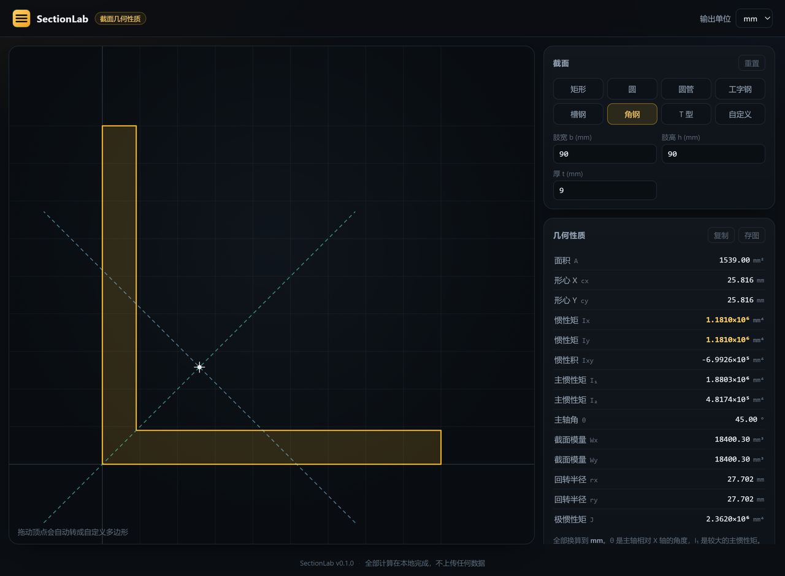
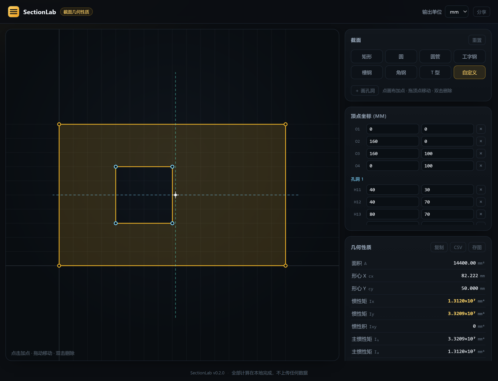

<div align="center">

# SectionLab · 截面工坊

**任意截面，拖一下就出全部几何性质。**

面积 · 形心 · 惯性矩 · 主轴 · 截面模量 · 回转半径 —— 带孔洞也行

[](#)
[](#)
[](#它为什么这么小)
[](LICENSE)

</div>



<p align="center"><sub>90×90×9 等边角钢。虚线是主轴（θ=45°），十字是形心，右边是全部几何性质</sub></p>

## 它能算什么

| 量 | 符号 | 说明 |
|---|---|---|
| 面积 | A | 带孔洞自动扣除 |
| 形心 | cx, cy | 任意多边形 |
| 惯性矩 | Ix, Iy | 关于形心轴 |
| 惯性积 | Ixy | 不对称截面不为零 |
| **主惯性矩** | I₁, I₂ | 最大 / 最小 |
| **主轴角** | θ | 相对 X 轴，归一到 ±90° |
| 截面模量 | Wx, Wy | 按最远纤维算 |
| 回转半径 | rx, ry | √(I/A) |
| 极惯性矩 | J | Ix + Iy |

单位可切 **mm / cm / in**，切换的是输出，输入永远是 mm。

## 支持的截面

内置 **7 种参数化型材**，改尺寸实时重算：

- 矩形、圆、圆管（带壁厚，输入即带孔洞）
- 工字钢、槽钢、等边角钢、T 型钢

**外加任意多边形**，支持挖任意多个孔洞：

- 画布上点击加点、拖动顶点、双击删除
- 点「＋ 画孔洞」进入挖孔模式，在轮廓里再点几下就是一个洞
- **顶点坐标表**可以精确输入数值（拖动只能到 0.1 mm，改尺寸要手输）
- 从预设拖动任意一个顶点，会自动转成自定义多边形——不用重画



<p align="center"><sub>160×100 板开 40×40 方孔：A=14400、cx=82.222、Ix=1.312×10⁷，孔洞按负面积 + 平行轴扣除</sub></p>

**分享**：右上角「分享」复制当前链接，打开就能还原同样的截面——自定义形状和孔洞都编码在 URL 里。

## 为什么不用 CAD / 在线工具

- **不用装软件**：一个 6 MB 的可执行文件，双击就开，浏览器里用
- **不联网**：全部计算在本地 JS 里跑，关掉网也能用，截面数据不出机器
- **不收费、不登录、不弹广告**：SkyCiv 这类在线工具免费版限制一堆
- **公式看得见**：源码就是公式，能自己核对

## 计算是怎么做的

全部基于**带符号面积的多边形积分**，孔洞天然是负面积，不需要特殊处理：

```
A   = ½ Σ (xᵢyⱼ − xⱼyᵢ)
Ix  = 1/12 Σ (yᵢ² + yᵢyⱼ + yⱼ²)(xᵢyⱼ − xⱼyᵢ)
Iy  = 1/12 Σ (xᵢ² + xᵢxⱼ + xⱼ²)(xᵢyⱼ − xⱼyᵢ)
Ixy = 1/24 Σ (xᵢyⱼ − xⱼyᵢ)(xᵢyⱼ + 2xᵢyᵢ + 2xⱼyⱼ + xⱼyᵢ)
```

然后平行轴定理移到形心：

```
Ix_c = Ix − A·cy²      Iy_c = Iy − A·cx²      Ixy_c = Ixy − A·cx·cy
```

主轴：

```
I₁,₂ = (Ix+Iy)/2 ± √(((Ix−Iy)/2)² + Ixy²)
θ    = ½·atan2(−2·Ixy, Ix−Iy)
```

## 测试

**36 条断言，全部对着解析解**，不是"跑通了就算对"：

```
node test/geometry.test.js
```

覆盖：矩形 `b·h³/12`、圆 `πR⁴/4`、圆管 `π(Ro⁴−Ri⁴)/4`、工字钢手算、
带方孔板的扣除、平移不变性、顶点方向无关性、旋转后的主轴不变量 `I₁+I₂ = Ix+Iy`、
以及退化输入必须报错而不是返回 NaN。

## 运行 / 构建

```bash
# 直接跑
go run ./cmd/sectionlab

# 构建单文件（Windows）
go build -trimpath -ldflags "-s -w" -o SectionLab.exe ./cmd/sectionlab
```

没有第三方依赖，`go build` 不需要联网。

推 `v*` 标签，GitHub Actions 会跑测试 + 交叉编译出 **Windows / Linux / macOS** 三个产物并发布。

## 限制（说在前面）

- 只算**几何性质**，不做应力验算、不算屈曲、不查规范
- **不含薄壁效应**：开口薄壁截面的扭转常数 Cw、J_t 不在计算范围内
- 孔洞必须完全落在轮廓内且互不重叠，否则会报错而不是硬算
- 惯性矩按**形心轴**给出，需要绕其他轴请自行平行轴换算

## 路线图

- [x] 自定义多边形挖孔
- [ ] 惯性矩绕任意指定轴
- [ ] 导入 DXF 轮廓
- [x] 导出 CSV
- [ ] 常用型钢库（H 型钢、角钢标准规格表）
- [ ] 撤销 / 重做

## License

[MIT](LICENSE)

---

### English

**SectionLab** is a tiny cross-section property calculator: area, centroid, moments of inertia,
principal axes, section moduli and radii of gyration for arbitrary polygons (with holes).

- 7 parametric presets (rectangle, circle, tube, I-beam, channel, angle, T-section) plus a
  free-form polygon you can draw and drag.
- Everything runs locally in the browser; the desktop app is a single ~6 MB binary with **zero dependencies**.
- 36 assertions against closed-form solutions; run `node test/geometry.test.js`.

MIT licensed.
